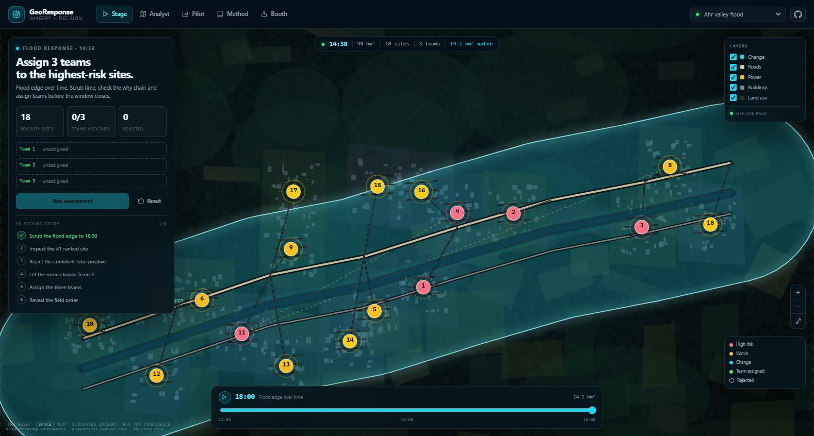
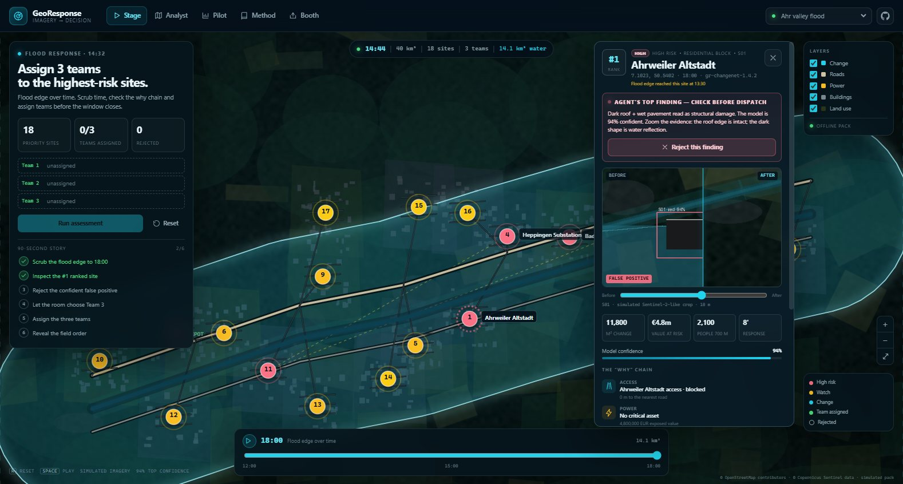
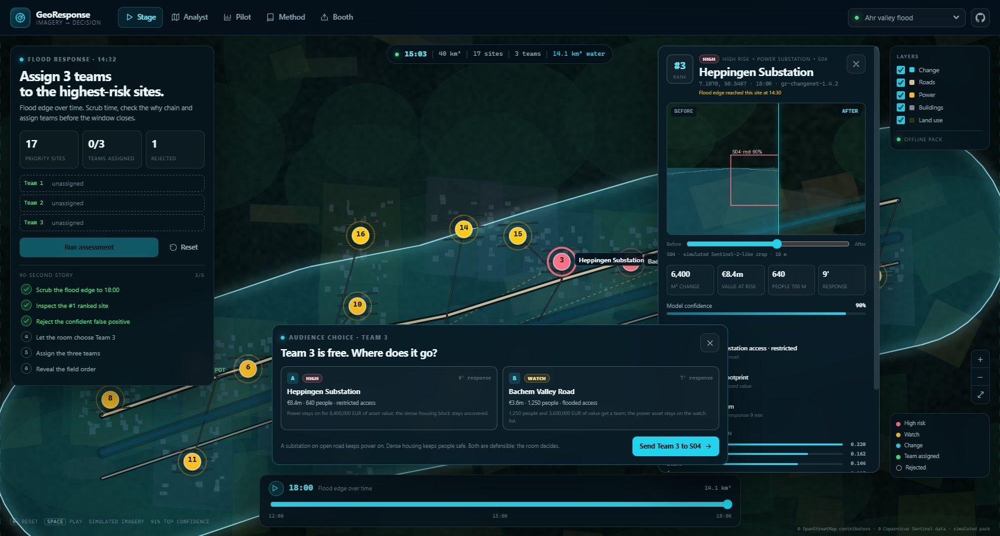
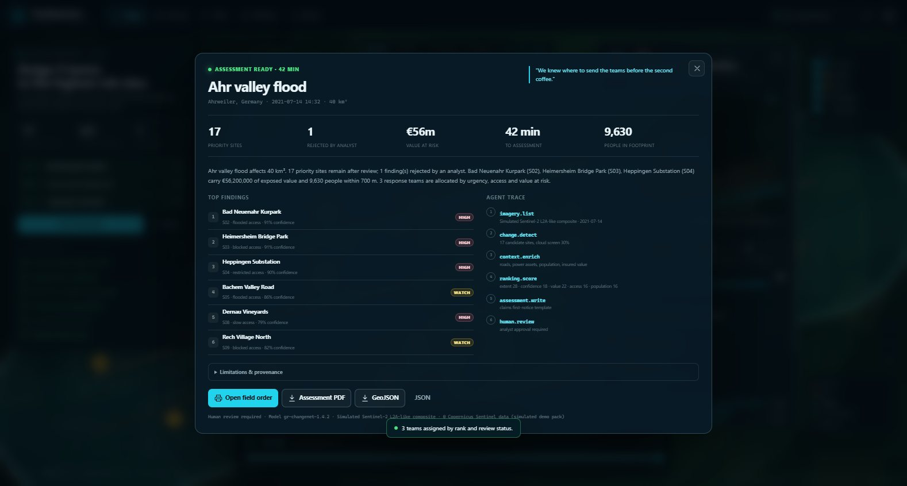
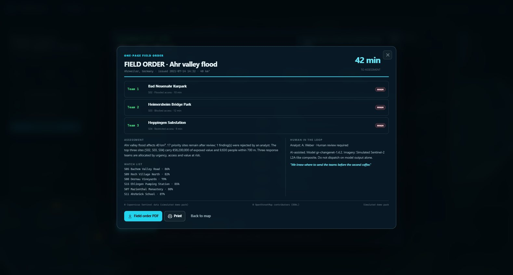
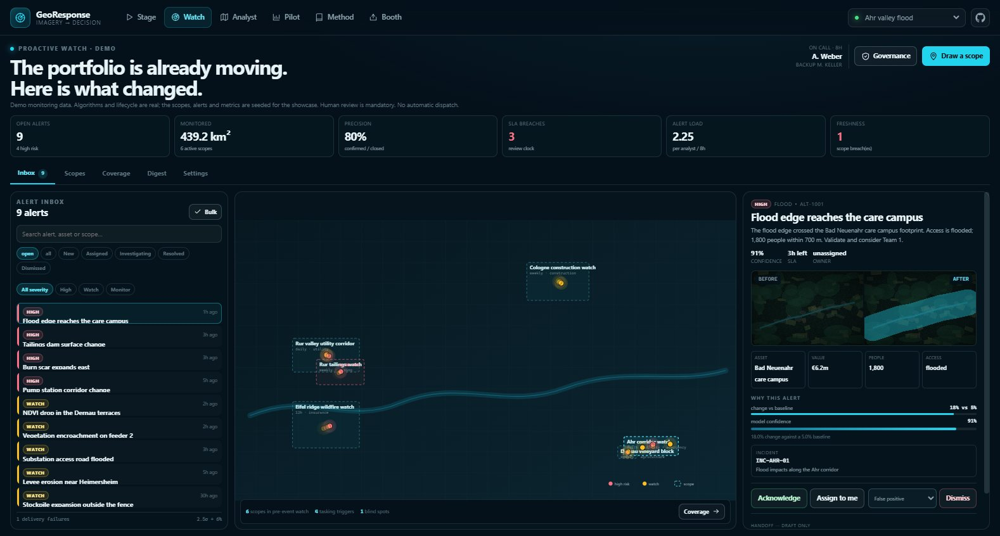
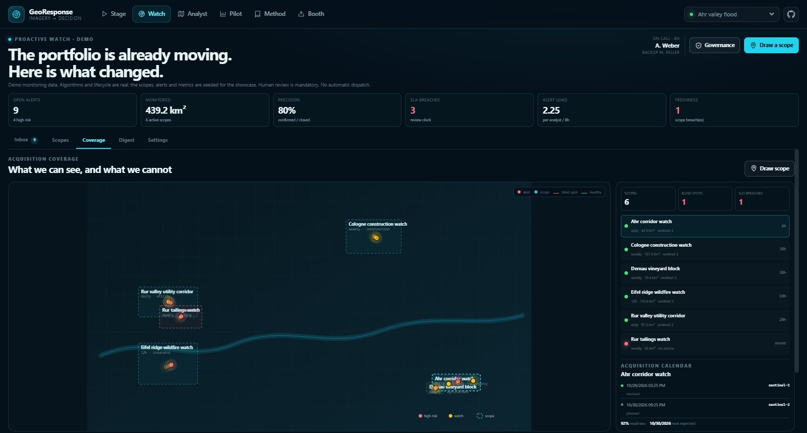
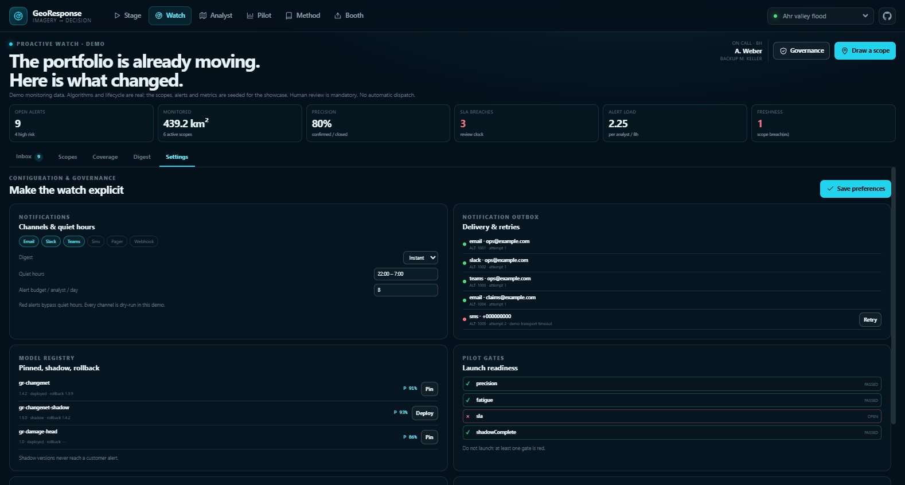
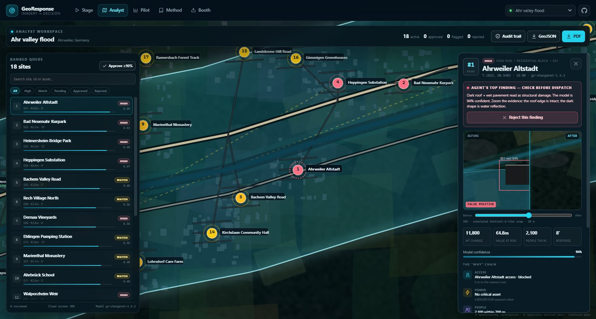
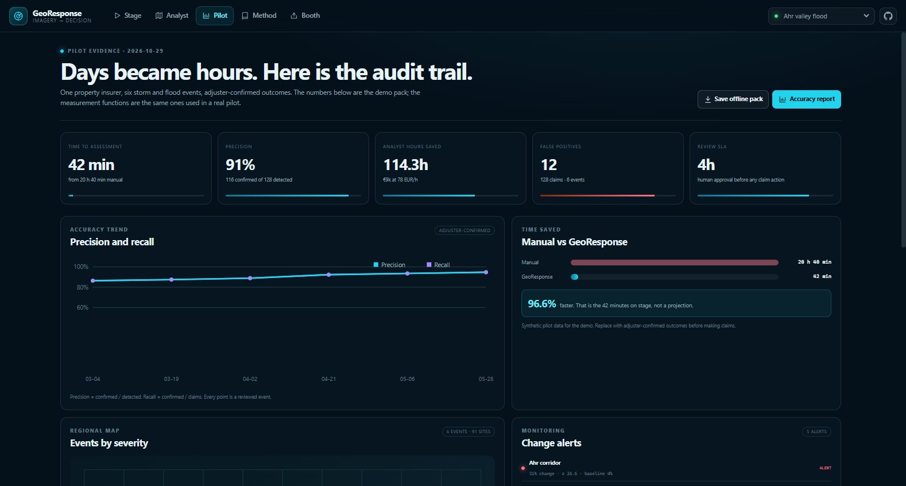

# GeoResponse

**When an area changes — flood, fire, damage or new construction — GeoResponse finds it, ranks what matters, and writes the assessment with a map. Hours, not days.**



**Live demo:** https://jiuwendemos.github.io/georesponse/ · **Stage plan:** [docs/ROADMAP.md](docs/ROADMAP.md) · **Method:** [docs/ARCHITECTURE.md](docs/ARCHITECTURE.md) · **Proactive design:** [docs/PROACTIVE.md](docs/PROACTIVE.md) · **2026 experience:** [docs/EXPERIENCE_2026.md](docs/EXPERIENCE_2026.md) · **Production wiring:** [docs/PRODUCTION_WIRING.md](docs/PRODUCTION_WIRING.md) · **Accessibility:** [docs/ACCESSIBILITY.md](docs/ACCESSIBILITY.md) · **Workspace data:** [docs/WORKSPACE.md](docs/WORKSPACE.md) · **Decision layer:** [docs/LAIX.md](docs/LAIX.md) · **Demo video:** [demo-video](demo-video) · **Example case:** [examples/workspace-example](examples/workspace-example)

GeoResponse is an AI analyst for imagery. It is built around one decision, not a dashboard: *where do we send the three teams?* The demo is a 90-second command story. The product is an analyst workspace with an audit trail, exports and a pilot measurement pack. Everything runs offline from a local data pack.

---

## The 90-second story

1. **14:32.** 40 km² under water. 18 places that matter. Three teams.
2. Scrub time from **12:00 to 18:00** and watch the flood edge move east.
3. Open the **#1 site** and see the why chain: access, power, people, value.
4. **The trust beat.** The top finding is a false positive — a dark roof and wet pavement read as damage. The analyst rejects it with a visible reason. The ranking re-orders and a team is freed.
5. **The room votes.** Team 3 goes to the substation or the dense housing block. Both are defensible; the trade-off is on screen.
6. **Reveal.** 40 km², 18 sites, 42 minutes, a one-page field order.

> *"We knew where to send the teams before the second coffee."*

| Trust beat | Audience choice |
|---|---|
|  |  |

| Assessment | Field order |
|---|---|
|  |  |

---

## What is built

### Stage / Booth
- Full-screen interactive map drawn locally, no WebGL and no tile server.
- 13-frame flood timeline, 18 sites, risk flipping from *watch* to *high risk* as the edge advances.
- Ranked queue with the “why” chain and rank-contribution bars.
- False-positive rejection that re-ranks the list in the same scene.
- Three-team assignment with coverage and response-time preview.
- Audience A/B vote with a visible trade-off.
- Zoom-out reveal, one-page field order, print stylesheet.
- Deterministic reset in under five seconds (`R`).
- Booth mode with scenario picker, 3-minute clock, 90-second script, offline pack.

### Watch (proactive)
- Scope model: corridor, portfolio, AOI or asset; cadence, freshness SLO, budget, exclusions, recipients.
- Alert inbox with dedupe, incident grouping, urgency, SLA countdown, owner and lifecycle.
- Evidence + “why this alert”, baseline sparklines, forecast watchlist and lead time.
- Coverage map with acquisition calendar, readiness, blind spots and scope drawing.
- Daily/weekly digest, quiet hours, notification outbox, retries and dead letters.
- Governance: model registry/rollback, validation gate, kill switch, audit chain, privacy review, pilot gates.
- Handoff drafts: assessment, claim, inspection, dispatch, ticketing, SIEM — never automatic.



| Coverage | Settings & gates |
|---|---|
|  |  |

### Analyst workspace
- Map + ranked list, filters and search.
- Evidence before/after slider per site.
- Approve / flag / reject with inline notes.
- Batch approve above a confidence threshold (90% default).
- GeoJSON (findings + change overlay) and PDF exports.
- Hash-chained audit trail with client-side verification.
- Dashboard: precision/recall trend, false-positive log, regional event map, monitoring alerts, time saved, pilot offer.

### Pipeline (Python)
- GeoTIFF tiling with projection normalisation (rasterio when installed, PNG+sidecar fallback).
- Paired-tile change detection, cloud screening, severity classification.
- Flood / wildfire / construction / NDVI change types.
- OSM-style context: roads, buildings, land use, power, population.
- Insured-property matching, asset value enrichment, road-access check.
- Transparent ranking: change extent, confidence, value at risk, access, population.
- Deterministic agent assessment with claims first-notice template and a tool trace.
- A small trainable damage head over observable features, with model card.
- Imagery connectors: Sentinel-2, Sentinel-1 SAR, Planet, Maxar, Airbus, ICEYE, Capella, local drone folder.
- Exports / integrations: GeoJSON, PDF, QGIS, ArcGIS, Guidewire, Duck Creek, Maximo, SAP.
- Recurring monitoring with baseline anomaly alerts.
- Tenant isolation, privacy review checklist, PII redaction.
- Optional NPU broker with batching, model pinning and a deployment profile.

### Offline & live
- Static app, no CDN, no third-party runtime.
- Service worker caches the shell and the data pack; “Save offline pack” pre-caches scenario JSON, basemaps and evidence.
- Deployable to GitHub Pages (workflow included) or a private host / Docker.

### Production wiring
- **Agent:** OpenAI-compatible tool loop and an openjiuwen `create_deep_agent` backend, both with preview/approve/undo and refusal rules. Run `py -m georesponse.cli agent --message "brief me"`.
- **Inference:** exported ONNX damage head running on ONNX Runtime; provider selection prefers CANN/OpenVINO/QNN/CoreML/CUDA and falls back to CPU. `py -m georesponse.cli infer --before ... --after ...`.
- **Imagery:** live Sentinel-2 STAC search + windowed COG fetch from Earth Search; real Ahr/Eifel/Cologne packs are committed. `py -m georesponse.cli fetch-imagery --scenario all`.
- **Notifications:** SMTP, Slack, Teams, Twilio SMS, PagerDuty and HMAC webhook transports; they fail loudly when unconfigured.
- **Integrations:** live Jira, ServiceNow, Guidewire, Duck Creek, Maximo, SAP, ArcGIS and SIEM HTTP adapters.
- **Platform:** PostgreSQL store, Redis queue, S3/MinIO object store, API-key/OIDC auth, hash-chained audit, worker, Docker Compose with Postgres/Redis/MinIO.
- **Truth:** `py -m georesponse.cli doctor` shows exactly which wiring is live. No secret is printed and no silent demo fallback is claimed.

See [docs/PRODUCTION_WIRING.md](docs/PRODUCTION_WIRING.md).

| Analyst | Pilot |
|---|---|
|  |  |

---

## Quick start

Requirements: Python 3.11+, Node 20+.

```powershell
# 1. Python core
py -m pip install -r requirements.txt

# 2. Build the offline demo data pack
py -m georesponse.datapack

# 3. Web app
cd web
npm install
npm run build      # or: npm run dev
npm test           # Vitest unit tests
npm run lint:design
npm run budget     # initial JS/CSS ≤ 250 KB gzip
npm run e2e -- --project=chromium   # Playwright + axe
cd ..

# 4. Serve the built app locally
py -m georesponse.cli static --port 4173
# open http://127.0.0.1:4173/
```

Optional pilot API:

```powershell
py -m georesponse.cli serve --port 8000
# http://127.0.0.1:8000/docs
```

Tests:

```powershell
py -m pytest -q
```

Docker:

```powershell
docker compose up --build
# http://127.0.0.1:8000/
```

---

## Provenance — read this before using the demo

The Ahr, Eifel and Cologne scenario basemaps are **real Sentinel-2 L2A windows fetched from the public Earth Search STAC catalogue** (Copernicus, free and open, attribution required). The images, capture dates and STAC item IDs are stored in `data/real/*/*.json`. Site coordinates, asset values and the flood/burn timeline are sample data until replaced with a customer's own assets and labels. The app labels the distinction in the provenance panel, Method page and field order.

Production sources:
- **Sentinel-2 / Sentinel-1** — free and open, attribution required. Live STAC/COG download implemented; the bundled Ahr/Eifel/Cologne pairs are real Sentinel-2 captures.
- **OpenStreetMap** — ODbL, displayed as “© OpenStreetMap contributors”.
- **Commercial imagery** (Planet, Maxar, Airbus, ICEYE, Capella) — requires a licence, even for a demo.
- **Customer drone orthophoto** — ingested through the local connector.

Every assessment carries the imagery source, model version, analyst and corrections. The app never auto-approves a claim; a human signs.

See [docs/DATA_RIGHTS.md](docs/DATA_RIGHTS.md) and the in-app **Method** page.

---

## Repository layout

```
georesponse/
  georesponse/            Python pipeline, ranking, assessment, exports, API, CLI
  data/                   source configs (scenario content lives in datapack.py)
  tests/                  131 pytest checks: geometry, detection, ranking, exports, audit, API
  web/                    React + TypeScript SPA (custom SVG map renderer)
    public/data/          real Sentinel packs, evidence, scenes, proactive demo portfolio
  docs/                   architecture, roadmap, stage runbook, pilot, privacy, data rights
  deploy/                 Dockerfile, compose, deployment notes
  .github/workflows/      CI + GitHub Pages
```

Generated packs are committed so the live app works without a build-time data job. Rebuild them with `py -m georesponse.datapack`; fetch fresh Sentinel imagery with `py -m georesponse.cli fetch-imagery --scenario all`.

---

## Roadmap status

All technical phases are implemented, including the 155 proactive workstreams, with field-validation artefacts where a live audience or customer is required. See **[docs/ROADMAP.md](docs/ROADMAP.md)** for the checkbox-by-checkbox evidence.

- Phase 0A — stage piece ✅
- Phase 0B — functional demo ✅
- Phase 1 — first pilot pipeline, workflow, measurement, deployment ✅
- Phase 2 — more change types, SAR, integrations, monitoring, compliance ✅
- Phase 3 — multi-tenant, government/agriculture/mining packs, partner motion ✅
- Product UI — analyst workspace and dashboards ✅
- Phase 4 — proactive monitoring ✅ — Watch inbox, scopes, coverage, forecast watchlist, digest, governance; see [docs/PROACTIVE.md](docs/PROACTIVE.md)
- Phase 5 — 2026 product experience · **in progress** — tokens and layered CSS, themes and density, command palette, agent sidecar, map clustering and camera, deep links, German shell, Playwright/axe/visual regression, design lint; see [docs/EXPERIENCE_2026.md](docs/EXPERIENCE_2026.md), [docs/DESIGN_SYSTEM.md](docs/DESIGN_SYSTEM.md), [docs/DESIGN_DEBT.md](docs/DESIGN_DEBT.md), [docs/RESEARCH_2026.md](docs/RESEARCH_2026.md), [docs/ROLLOUT_2026.md](docs/ROLLOUT_2026.md)
- Phase 6 — production wiring · **built, cutover pending** — real LLM/openjiuwen agent, ONNX/NPU providers, live Sentinel STAC, live notifications/integrations, Postgres/Redis/S3, auth, worker and doctor; see [docs/PRODUCTION_WIRING.md](docs/PRODUCTION_WIRING.md)
- Phase 8 — **manager demo & daily workspace** · **in progress** — 90-second and 10-minute cuts, visible vote consequence, manager proof page, Watch as the returning home, portfolio tasks, pilot proof; see [docs/ROADMAP.md](docs/ROADMAP.md) Phase 8
- Phase 7 — **make it proactive, 2026 and connected** · **planned, 306 open checkboxes** — continuous sensing and escalation; screen-by-screen 2026 migration and research gates; live openjiuwen default, NPU, commercial imagery, notifications, enterprise systems, platform, identity, observability and cutover; see [docs/ROADMAP.md](docs/ROADMAP.md) Phase 7 and [docs/PHASE7_STATUS.md](docs/PHASE7_STATUS.md)

The proactive phase is built as the **Watch** tab and `georesponse/proactive/`: scheduled scopes, seasonal baselines, multi-temporal and optical/SAR confirmation, forecast watchlists, alert lifecycle, notification outbox, integrations, governance and pilot gates. The demo portfolio is seeded; the launch gate is deliberately red until a real corridor pilot clears it.

Three items are field tests, not code: the five-stranger test, volunteer completion and the seven-of-ten closing-line recall. A runnable scorecard is in [docs/SCORECARD.md](docs/SCORECARD.md); no result is fabricated.

---

## Commercial

The first market is property insurance — storm and flood damage assessment. The first pilot is one insurer, one event, one region, 90 days, run in parallel with the manual process. The success measures, deliverables and pilot offer are in [docs/PILOT.md](docs/PILOT.md).

**Human in the loop. No automated decisions about people or property.**

---

## License

Apache-2.0. See [LICENSE](LICENSE).

Data attribution: © OpenStreetMap contributors (ODbL) · © Copernicus Sentinel data (live pack; attribution on screen).
